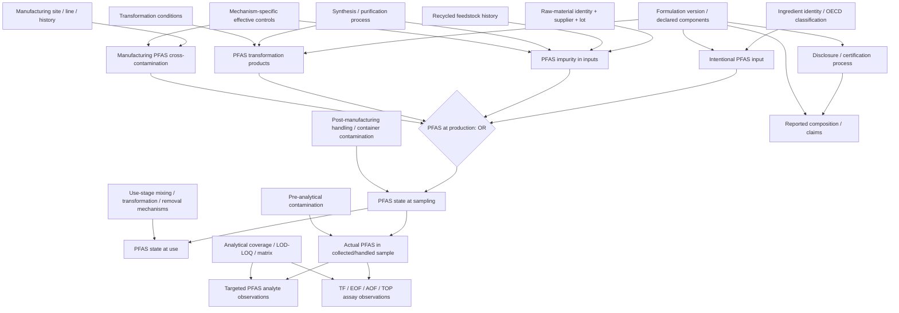

# BN-0 — BN-Chemical DAG v1.0 (Candidate for Structural Freeze)

**Decision baseline:** 72 decisions (1–72); decision 72B closes scope to consolidation, DAG, Node Dictionary and review. **Status:** consolidated working draft, **not yet scientifically validated/frozen**. BN-Material, CPT estimation and application development are outside BN-0.

## 1. Objective and boundaries

Target: `PFAS_Presence ∈ {Yes, No}` for a chemical formulation at a **specified lifecycle point**, meaning at least one substance satisfying **OECD 2021 PFAS structural definition** is actually present, regardless of concentration or regulatory compliance. `Unknown` means an unobserved state, not a third chemical outcome. No assumption that a negative targeted panel exhaustively excludes PFAS.

At production, formulation PFAS presence is the deterministic **OR** of four non-exclusive routes: (1) intentionally added PFAS, (2) PFAS impurity, (3) PFAS transformation products, and (4) manufacturing cross-contamination. Source routes represent **physical routes**, not the document reporting them. An identified input must not appear as both a raw-material route and a separately counted fifth route.

**Boundary:** `BN-Chemical` only; a chemical may later be used on a material but full `BN-Material` and transfer/retention in materials are deferred. Formulation → version → batch, with raw-material lots and manufacturing site/line. Temporal states separate production, sampled product and use; sample-collection artifacts do not redefine the original formulation's state.

## 2. Consolidated DAG (conceptual, node labels are canonical interfaces)

**Reading cautions:** Diagram is a *compressed schematic*. The `OR` rule is deterministic on actual source states; presence at later points must be modeled by state-transition mechanisms (do not assume storage or dilution magically removes presence). `DOC` is evidence about declared formulation, not a source of PFAS; `TARGET` and `SCREEN` are **effects** of sample composition and measurement, never causes of PFAS. TF/EOF/AOF signals do **not** equate to confirmed PFAS identity. `CTRL` represents separate effectiveness for ingredient, synthesis, manufacturing contamination, and post-manufacturing control; it is not a single universal quality score. Edge `FV → DOC` means formulation information may inform documents via disclosure, not that documentation proves true composition.

## 3. Seven modules and their interfaces

| Module | Core contents | Interface out |
|---|---|---|
| Chemical Identity | identities, CAS/structure/type and OECD classification | `PFAS_CLASS` used for ingredient identity and analytical identity interpretation |
| Formulation | product, version, components, manufacturing batch, intended chemistry, disclosure context | `INTENT`, `TRANSFORM`, and `PROD_STATE` |
| Raw Material | input identity, upstream supplier, lot, synthesis/purification, recycled feedstock history, impurity | `IMPURITY` into production aggregation |
| Manufacturing | manufacturing site and line, history, mixing, control effectiveness, cross-contamination | `CROSS_CONTAM` into production aggregation |
| Lifecycle | production state, downstream handling, state at sampling, state at use | `SAMPLE_TIME_STATE` to sample measurement |
| Measurement | sampled/handled material, preanalytical contamination, test method, target lists, observed signals | `ANALYTICAL_EVIDENCE` |
| Evidence | declaration, claims, provenance, scope, missingness, quality/transferability | Validated observations/metadata into the appropriate observation model; **not** an extra physical PFAS route |

## 4. Structural invariants (must pass before freeze)

1. **Deterministic identities:** Structure-based OECD classification, once the relevant structure is adequately known, is a deterministic rule. CAS alone is insufficient; unresolved polymer/UVCB remains a substance-level uncertain state (decision 62A).
2. **Production aggregation:** `PROD_STATE = OR(INTENT, IMPURITY, TRANSFORM, CROSS_CONTAM)`. These source events can co-occur and are correlated through shared causes. Avoid treating a mechanism's posterior as its proportional causal contribution.
3. **Temporal scope:** Presence is at a specified stage. `PROD_STATE → SAMPLE_TIME_STATE → USE_STATE` needs mechanism-aware transitions. Sample preparation contamination only affects `SAMPLE_STATE` and analytical observations, not `SAMPLE_TIME_STATE`.
4. **Observation direction:** True states/concentrations → measured signal; method coverage and performance → measured signal. Bayesian inference updates beliefs backwards without reversing causality.
5. **Published laboratory results:** Per 56A/57C, officially published results are **presumed QC-valid for BN-0 ingestion**, barring explicit invalidation/retraction/material error. This is an operational assumption, not proof that the originating laboratory QC passed. Do not construct detailed QC nodes.
6. **Evidence fidelity:** Preserve analyte, concentration, units, detection qualifier and published LOD/LOQ as source metadata (58B). For the initial model, values below LOD/LOQ collapse to an analytical `Not_Detected` evidence category (59A); **never** equate with zero concentration or chemical absence. Retain the reporting limit to prevent interpreting distinct assays as equivalent.
7. **Identity threshold:** Only confirmed PFAS identities update identification-specific targeted evidence (60A). Suspect/unidentified organofluorine signals are not PFAS identity confirmations. Aggregate TF/EOF/AOF remains admissible as **indirect, nonspecific measurement evidence** (53B), conditioned on limitations.
8. **No spurious geographical risk:** Site, production year, supplier, country and category are context/cause proxies; no direct causal PFAS edge simply from supplier location or product label.
9. **Source/provenance:** Records, claims and certifications are fallible observations, dependent on coverage/time/formulation version/batch. A repeated citation of the same original assay is not independent evidence.
10. **Uncertainty and transfer:** Missingness mechanisms, sample-selection mechanisms, applicability domain, dataset shift, shared technology and structural alternatives are documented and selectively modeled if essential; none is an automatic extra source of PFAS.

## 5. Boundary between causal DAG, measurement and metadata

- **BN causal/latent states:** Four PFAS mechanisms, true formulation/batch/lifecycle/sample states, chemistry-process causes, and the effective control factors that causally alter source routes.
- **Observation nodes:** Reported ingredient declarations, targeted analytical results, total fluorine/EOF/AOF/TOP measurements, and test-specific observation channels. A measured `Not Detected` is an observation, never a physical chemistry state.
- **Metadata/outside DAG by default:** CAS string, source citation DOI/URL, timestamps and identifiers, QC acceptance flag, analytical target-list entries, regulatory thresholds, version IDs, confidence/provenance tags, model applicability and documentation of assumptions. When such context causally governs observation or missingness, represent the underlying mechanism instead of an opaque label.
- **Deferred beyond BN-0:** actual numerical CPTs, selection of continuous distributions, EVI/EIG algorithm, causal `do()` identification, transfer-learning/calibration algorithms, regulatory classification outputs, software implementation, and BN-Material.

## 6. Freeze review register (must resolve, not new design questions)

| ID | Item | State / action |
|---|---|---|
| FR-01 | Map each previously discussed node to canonical dictionary ID or metadata | Consolidated first pass; review aliases before final freeze |
| FR-02 | Check every proposed causal edge for mechanism, temporal ordering and scientific support | Review required; conceptual edges ≠ established scientific facts |
| FR-03 | Check DAG acyclicity, duplicate paths and double-counting | Required when formal DAG is instantiated |
| FR-04 | Confirm production OR input definitions are nonoverlapping physical events | Required; same underlying PFAS occurrence may be explained by upstream and downstream nodes |
| FR-05 | Confirm declared/sample/published measurement evidence does not overwrite true chemistry | Conceptual review passed; test with cases |
| FR-06 | Confirm source-scoped test results, ND/limits and exact analyte identities | Conceptual review passed; detailed QA deferred |
| FR-07 | Mark context-specific and uncertain edges (`Uncertainty_Status`) | Required before freeze |

**Freeze status:** `DRAFT — ready for structured scientific review`, not `FROZEN`. Decision 71B establishes the *criteria* for freeze; decision 72B establishes *no more scope expansion*. Scientific review/edge cleanup is the only remaining BN-0 work, not a new series of design choices.
